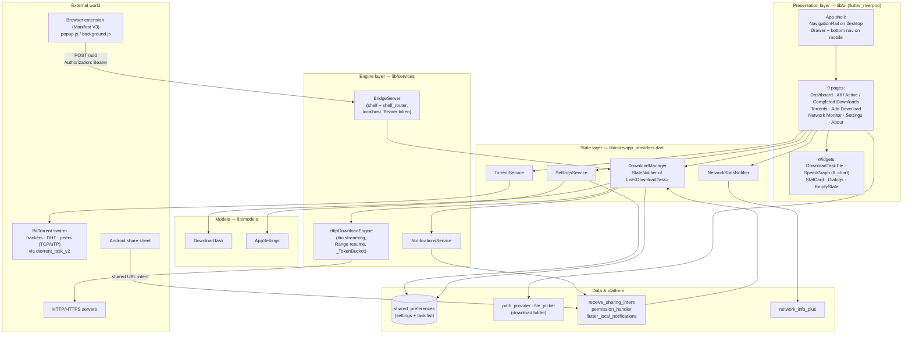
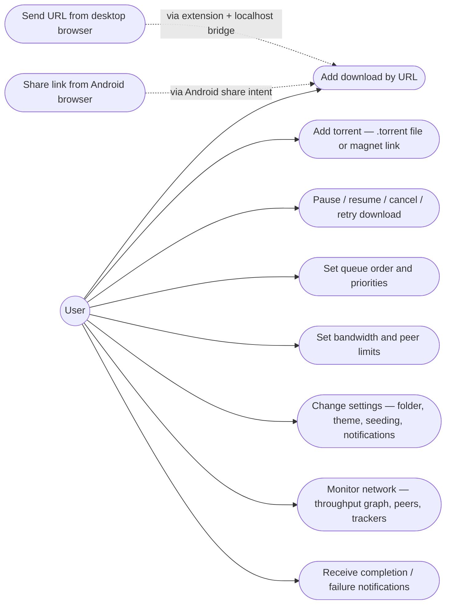
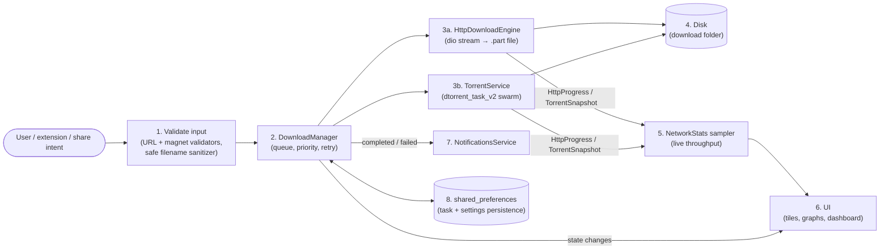
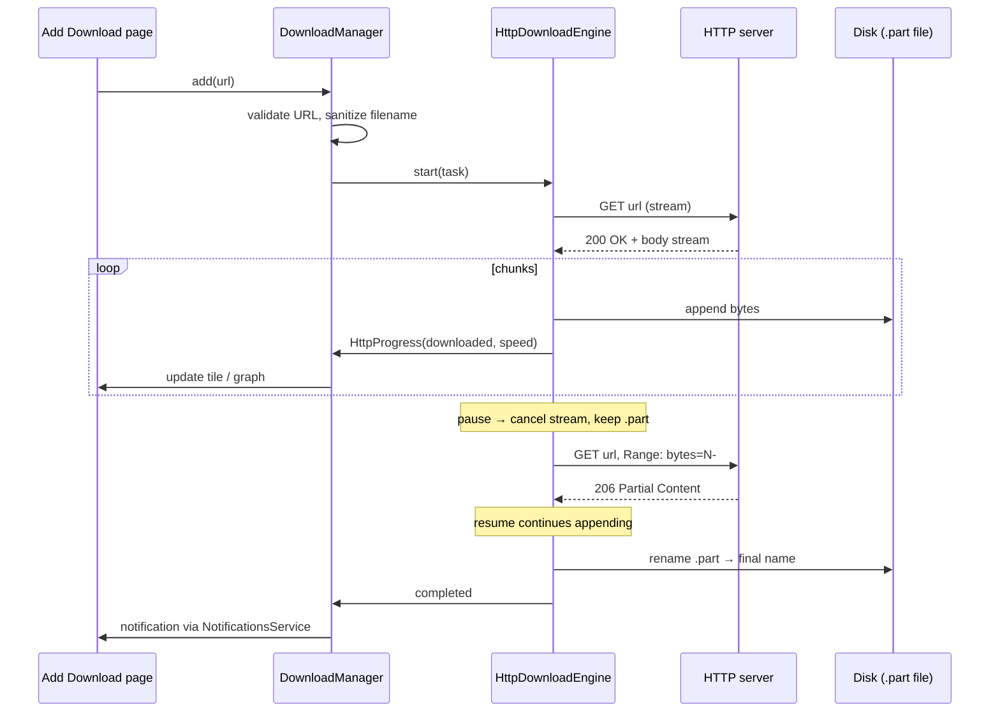
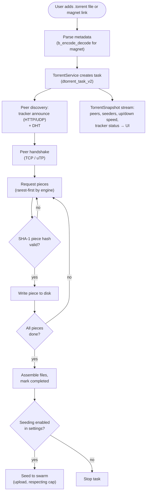
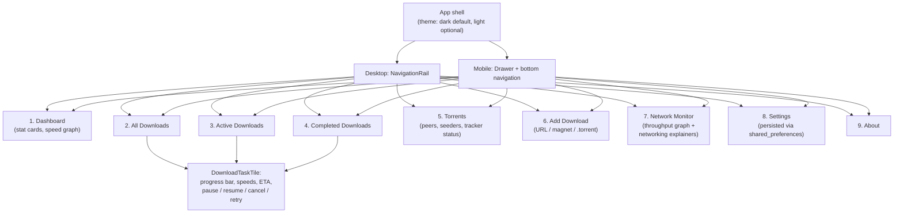

# NetTorrent — Architecture Diagrams (Phase 8)

Mermaid source diagrams for the academic report (chapters 12–20) and the
teacher presentation. Every box below maps to a real file in this repo —
`lib/` has 31 Dart files; the key ones are named in the notes under each diagram.

Render these with any Mermaid renderer (mermaid.live, the Mermaid VS Code
extension, or GitHub markdown preview).

---

## 1. System architecture (report chapter 12)

**Notes.** `DownloadManager` owns the queue, priorities, retry-with-backoff
and persistence. `HttpDownloadEngine` never fabricates progress: every speed
and percentage comes from the `HttpProgress` stream sampler. `TorrentService`
wraps the pure-Dart `dtorrent_task_v2` engine (tracker + DHT + uTP/TCP);
magnet metadata is decoded with `b_encode_decode`.

---

## 2. Use-case diagram (report chapter 13)

---

## 3. Data-flow diagram (report chapter 14)

---

## 4. HTTP/HTTPS download process (report chapter 18)

---

## 5. BitTorrent protocol workflow (report chapter 19)

---

## 6. UI navigation map (report chapter 20)

---

*Generated 2026-10-16 from the phase 1–6 codebase (`flutter analyze` clean,
34/34 unit tests passing). Pending real-device runs: screenshots for
chapter 27 and any measured benchmarks — these must come from actual builds,
never fabricated.*
